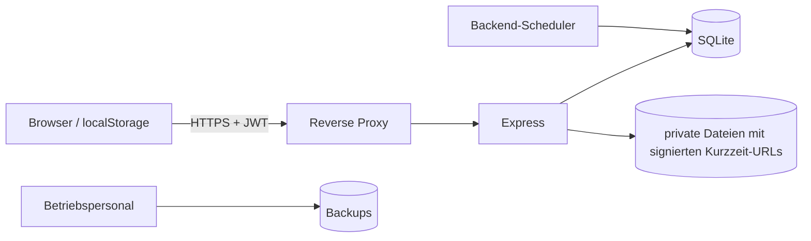

# Sicherheitsmodell

## Schutzbedarf

Tabletto verarbeitet Zugangsdaten und Informationen, aus denen persönliche
Medikation abgeleitet werden kann. Datenbank, Uploads, Backups und Logs sind
daher vertraulich zu behandeln. Die Anwendung ist kein medizinisches Gerät und
soll keine Therapieentscheidung treffen.

## Vertrauensgrenzen

Browser, Proxy, API, persistente Daten und Backups sind getrennte
Vertrauensbereiche. Ein geschützter UI-Pfad ersetzt niemals Backend-Autorisierung.

## Authentifizierung

- Passwörter werden mit bcrypt und Kostenfaktor 10 gehasht.
- JWTs werden mit `JWT_SECRET` signiert und laufen nach sieben Tagen ab.
- JWT-Inhalt: Benutzer-ID und E-Mail; keine Rollen oder medizinischen Daten.
- Fehlender Token ergibt 401, ungültiger/abgelaufener Token 403.
- Fehlgeschlagene Logins sind auf fünf, fehlgeschlagene Registrierungen auf zehn
  Anfragen pro Minute und Client begrenzt.

Risiken:

- Produktion startet ohne ein explizites, vom bekannten Entwicklungswert
  abweichendes `JWT_SECRET` nicht.
- Tokens liegen in `localStorage` und sind bei erfolgreichem XSS auslesbar.
- Es gibt keinen serverseitigen Logout, Token-Widerruf oder Refresh-Mechanismus.
- Hinter Reverse Proxies muss die Client-IP-Ermittlung für Rate Limiting geprüft
  werden; `TRUST_PROXY` setzt die erwartete Proxy-Topologie explizit.

## Autorisierung und Mandantentrennung

Medication-Models begrenzen normale Abfragen durch `id` und `user_id`. History
wird ebenfalls mit `user_id` abgefragt. Dieses Muster ist zwingend beizubehalten.

Alle geschützten Controller verwenden die JWT-Eigenschaft `req.user.id`.

Erforderlicher Regressionstest: Benutzer A darf IDs von Benutzer B weder lesen,
ändern, löschen noch über Fotos oder History erschließen.

## SQL und Datenintegrität

Normale Queries verwenden Platzhalter. Dynamische Update-Spalten werden aus
festen Feldlisten zusammengesetzt. `PRAGMA foreign_keys = ON` erzwingt
Referenzen und Löschkaskaden.

Bestandsupdate und History-Insert sind atomar. Allgemeine Updates durchlaufen die
vollständige Medikamentenvalidierung und dürfen keinen Bestand verändern.
Migrationen brechen bei Fehlern den Start ab. Mehrere App-Prozesse auf derselben
SQLite-Datei bleiben kein unterstütztes Skalierungsmodell.

## Uploads

Schutzmaßnahmen:

- Multer-Limit 5 MiB
- MIME-Typ ist JPEG, PNG, GIF oder WebP
- zufällige serverseitige Dateinamen
- relative Pfade in der Datenbank
- feste serverseitige Erweiterung und Prüfung der Dateisignatur
- Containment-Prüfung nach `path.resolve()`
- fünf Minuten gültige HMAC-signierte Auslieferungs-URL
- Import übernimmt keine Fotoverweise

## CORS und Transport

Ohne `FRONTEND_ORIGIN` ist CORS in Produktion deaktiviert. Ein getrenntes
Frontend muss die exakte HTTPS-Origin setzen. TLS endet typischerweise am Reverse
Proxy; Port 3000 sollte nicht zusätzlich öffentlich erreichbar sein.

Das Backend setzt CSP, `nosniff`, Frame-Schutz, Referrer- und Permissions-Policy.

## PWA-Cache

Der Service Worker cached ausschließlich die statische Anwendungshülle. Private
API-Antworten werden nicht persistiert. Logout entfernt zusätzlich eventuell aus
älteren Releases vorhandene API-Caches.

## Secrets und Konfiguration

- `.env` bleibt unversioniert.
- Secrets über Deploymentplattform oder geschützte Secret Stores setzen.
- Keine Secrets in Compose-Dateien, Images, Logs oder Screenshots schreiben.
- `JWT_SECRET` rotieren, wenn Offenlegung vermutet wird; alle Tokens werden
  dadurch ungültig.
- Produktionsbackups verschlüsseln und getrennt vom Anwendungsserver lagern.
- `SMTP_*`-Variablen bleiben im Backend; sie werden ausschließlich vom
  Mailmodul gelesen und tauchen in keiner API-Antwort oder im PWA-Frontend auf.
- Der Testmail-Endpunkt ist authentifiziert, sendet ausschließlich an die
  registrierte Adresse des angemeldeten Benutzers, gibt keine SMTP-Fehlerdetails
  zurück und ist auf drei Aufrufe je Benutzer in zehn Minuten begrenzt.

## Container

Das Runtime-Image startet über `gosu` als nicht privilegierter `appuser`.
`compose.yaml` setzt `no-new-privileges:true`, begrenzt Ressourcen und rotiert
JSON-Logs. Produktion zieht ausschließlich das veröffentlichte GHCR-Image.

Der Entrypoint läuft zunächst als root, um rekursiv Besitzrechte zu ändern. Bei
Bind Mounts muss geprüft werden, ob dies unerwünschte Host-Berechtigungen ändert.

## Logs und Backups

Schedulerlogs enthalten keine Medikamentnamen oder Bestände. Fehlerantworten
enthalten keine Stacktraces oder internen Fehlermeldungen.

Das Backup-Skript erzeugt mit `VACUUM INTO` einen konsistenten SQLite-Snapshot und
kopiert ausschließlich referenzierte Fotos in dasselbe versionierte Verzeichnis.
Eine auf der Quelldatenbank gehaltene Schreibsperre verhindert dabei Änderungen
der Fotoreferenzen und Dateibereinigung. Fehlende referenzierte Dateien lassen
die gesamte Sicherung fehlschlagen; temporäre Sicherungen werden entfernt. Externe Verschlüsselung und
Restore-Tests bleiben Betreiberpflicht.

## Produktionscheckliste

- [ ] starkes, extern verwaltetes `JWT_SECRET`
- [ ] HTTPS erzwungen; Port 3000 nicht öffentlich
- [ ] `FRONTEND_ORIGIN` exakt gesetzt
- [ ] nur eine scheduleraktive Instanz
- [ ] persistentes Volume für Datenbank und Uploads
- [ ] verschlüsselte externe Backups und getesteter Restore
- [ ] Zugriff auf Logs und Backups beschränkt
- [ ] Health Check prüft JSON und Datenbank, nicht nur HTTP 200
- [ ] Upload- und PWA-Cache-Risiken für das Einsatzmodell bewertet
- [ ] Abhängigkeiten und Containerbasis regelmäßig aktualisiert
- [ ] Zwei-Benutzer-Autorisierungstests erfolgreich

## Meldung von Schwachstellen

Keine echten Benutzerdaten oder Exploit-Secrets in öffentliche Issues schreiben.
Eine Meldung sollte betroffene Version, reproduzierbare Schritte, Auswirkung und
eine datensparsame Beispielanfrage enthalten.

## Ergänzungen des Master-Audits

- Alle Reads und Writes auf der gemeinsamen SQLite-Verbindung werden koordiniert.
  Export-Reads sehen keinen teilweise importierten Zustand. Die Queue ist keine
  Unterstützung für mehrere schreibende App-Replikate.
- Fotoaustausch liest den vorherigen Pfad in derselben Transaktion wie das Update;
  verworfene Uploads werden entfernt. Pfadcontainment bleibt unverändert; Cleanup
  löscht nur nicht referenzierte lokale Dateien unter Datenbanksperre.
- Import prüft Quell-IDs, Zeitstempel, Bestandsbereiche und Referenzen vor Replace.
  Historische Termine sind Archivdaten und keine neue Einnahmeempfehlung.
- Die CSP ergänzt `font-src 'self' data:` für FullCalendars eingebettete Schrift.
  Skript-, Verbindungs- und Framegrenzen bleiben eng; externe Fonts sind nicht erlaubt.
- Das Passwortformular löscht Eingaben nach Erfolg. Ein falsches aktuelles Passwort
  ist eine fachliche 401 und löscht den JWT nicht; ungültige JWTs bleiben 403.
- Statusmarker werden erst nach erfolgreicher SMTP-Annahme gespeichert. Bei Fehlern
  erfolgt ein erneuter Versuch; eine Zustellungsgarantie an das Endgerät besteht nicht.

## Abhängigkeiten nach dem Audit (25.10.2026)

Die beim zusätzlichen Imagebau gefundenen Paketmeldungen wurden über aktualisierte
Lockfiles, Multer ab 2.5.0 und Nodemailer ab 10.2.1 behoben. Nodemailer 10 setzt
Node >=20 voraus; das Projekt benötigt bereits >=20.17.0. Die verwendete
CommonJS-/SMTP-Schnittstelle bleibt erhalten und ist durch Fake-SMTP-E2E geprüft;
der [Upstream-Changelog](https://github.com/nodemailer/nodemailer/blob/master/CHANGELOG.md)
dokumentiert die Parser-/SMTP-Korrekturen.

Im Frontend erzwingt ein npm-Override `postcss-selector-parser >=7.1.6`, damit die
bestehende Tailwind-3-Buildkette einen korrigierten Selector-Parser verwendet.
Das Override kann nach einer späteren Tailwind-Aktualisierung entfernt werden,
sobald dessen transitiver Parser ebenfalls korrigiert ist. Produktionsbuild,
Desktop-/Mobile-Workflows und schmale Viewports prüfen die Integration.
`npm audit` meldet zum Prüfzeitpunkt in Backend und Frontend jeweils 0 bekannte
Schwachstellen; dies ersetzt keine laufende Aktualisierung der Abhängigkeiten.
